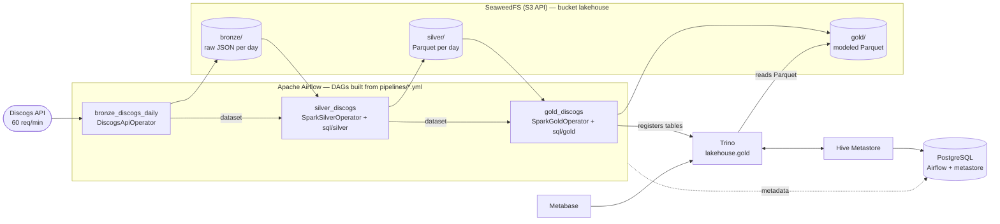
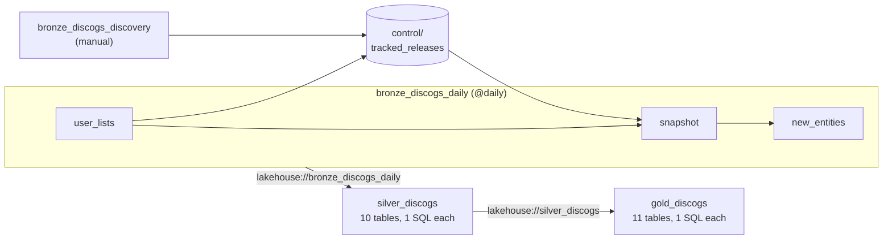

# Discogs Data Lake

[](https://github.com/VitorMusachio/discogs-data-lake/actions/workflows/ci.yml)

A local lakehouse built on [Discogs API](https://www.discogs.com/developers/) data, organized in
**Bronze → Silver → Gold** layers. Its core is a **daily snapshot** of demand (`have`/`want`) and price (lowest offer
in USD) for a set of tracked releases, which makes trends over time visible, plus users' collections and wantlists.

DAGs are **declarative**: each file in `pipelines/*.yml` becomes an Airflow DAG. It holds the schedule, the upstream
DAGs, the tasks, the operator for each task and its quality checks. In silver and gold, each task builds one table from
a SQL file. A generated **lineage** keeps cross-DAG dependencies consistent, and CI fails when they are not.

## Tools

<table>
  <tr>
    <td align="center" width="110"><br/><b>Airflow 2.9</b><br/><sub>orchestration</sub></td>
    <td align="center" width="110"><br/><b>Spark 3.5</b><br/><sub>transformation</sub></td>
    <td align="center" width="110"><br/><b>SeaweedFS</b><br/><sub>S3 storage</sub></td>
    <td align="center" width="110"><br/><b>Hive Metastore 4</b><br/><sub>catalog</sub></td>
    <td align="center" width="110"><br/><b>Trino</b><br/><sub>SQL queries</sub></td>
  </tr>
  <tr>
    <td align="center" width="110"><br/><b>Metabase</b><br/><sub>visualization</sub></td>
    <td align="center" width="110"><br/><b>PostgreSQL 16</b><br/><sub>metadata</sub></td>
    <td align="center" width="110"><br/><b>Python 3.11</b><br/><sub>ingestion and operators</sub></td>
    <td align="center" width="110"><br/><b>Docker Compose</b><br/><sub>local environment</sub></td>
    <td align="center" width="110"><br/><b>GitHub Actions</b><br/><sub>CI</sub></td>
  </tr>
</table>

## Architecture



### Layers and DAGs



- **Bronze** (`DiscogsApiOperator`): API ingestion, no SQL. The YAML picks the collector (`discovery`, `user_lists`,
  `snapshot`, `new_entities`). Each run writes raw JSON to `bronze/<entity>/dt=<ds>/`.
- **Silver** (`SparkSilverOperator`): each task reads the `bronze_*` sources its SQL cites, with the schema declared in
  the YAML, and writes `silver/<table>/dt=<ds>/`. It runs when bronze finishes and processes the same date.
- **Gold** (`SparkGoldOperator`): each task reads the `silver_*` tables its SQL cites, rebuilds `gold/<table>/` and
  registers it in Trino (`lakehouse.gold`) as an external Hive Metastore table.
- Both Spark operators share one base (`SparkSqlOperator`): Spark session, running the SQL, writing and checks. Each
  subclass only changes what is specific to its layer.
- **Storage**: SeaweedFS provides an S3-compatible API (MinIO, used before, stopped publishing public images). Spark
  writes with the S3A `directory` committer, because the default commit relies on *rename*, which on S3 is a copy and
  fails on SeaweedFS.

### Lineage

[`docs/lineage.md`](docs/lineage.md) (and `docs/lineage.json`) is generated from the YAML and SQL. It shows the producer,
upstream and downstream of every dataset. The same build enforces three rules:

1. every dataset a task reads has a producer;
2. each silver/gold table has exactly one writer;
3. some producer of every input runs first: in an upstream DAG reachable through `schedule.after`, or in an upstream
   task of the same DAG.

A broken rule stops the DAG factory (an import error in Airflow), `make lineage-check` and CI. The pre-commit hook
regenerates the docs whenever `pipelines/` or `sql/` change. CI fails if the committed copy is stale.

## Repository layout

```
pipelines/                 one DAG per YAML file
  bronze_discogs_discovery.yml
  bronze_discogs_daily.yml
  silver_discogs.yml       bronze sources (schemas) + tables
  gold_discogs.yml
sql/
  silver/<table>.sql       one table per file
  gold/<table>.sql
dags/pipelines.py          reads pipelines/*.yml and builds the DAGs (no need to edit)
src/discogs_pipeline/
  spec.py                  YAML parsing and validation (no Airflow)
  lineage.py               table-level lineage, dependency rules, docs/lineage.*
  dag_factory.py           YAML -> Airflow DAG
  operators/               one operator per kind of transformation
    base.py                LakeOperator: settings and partition date
    ingestion.py           DiscogsApiOperator (bronze)
    spark.py               SparkSqlOperator -> SparkSilverOperator / SparkGoldOperator
  transform.py             Spark core: register views, run SQL, write, run checks
  collectors/              API collectors (discovery, users, snapshot, entities)
  api.py                   client with rate limiting, retries and pagination
config/tracking.yml        usernames, discovery seeds and limits
docs/lineage.{md,json}     generated lineage
tests/unit                 no Docker (local Spark)
tests/integration          inside the Airflow container, with the stack up
AGENTS.md, CLAUDE.md       rules for coding agents; .claude/rules and .claude/skills
```

## Declaring a DAG

```yaml
# pipelines/gold_discogs.yml
dag_id: gold_discogs
layer: gold                      # bronze | silver | gold
schedule:
  after: [silver_discogs]        # runs when that DAG finishes (dataset); or "@daily", cron, null
max_active_tasks: 2              # each Spark task starts its own JVM
tasks:
  fact_release_snapshot:
    operator: spark_gold         # discogs_api | spark_silver | spark_gold
    sql: gold/fact_release_snapshot.sql   # optional: defaults to <layer>/<task>.sql
    partition_by: dt_snapshot
    upstream: []                 # tasks in the same DAG
    checks: {unique: [id_release, dt_snapshot], not_null: [id_release], min_rows: 1}
```

**New table:** create `sql/<layer>/<name>.sql`, add the task to the layer's YAML, then run `make lineage`.

Validation runs when Airflow parses the DAGs and in the tests, so a broken DAG shows up as an import error instead of
failing at runtime. It checks:
- the operator exists and fits the layer, and its required parameters are set;
- `upstream` tasks exist and form no cycle;
- the DAGs in `after` exist, and so do the SQL files;
- every view the SQL reads (`bronze_*` / `silver_*`) is declared.

## Gold model

| Table | Grain | Source |
|---|---|---|
| `fact_release_snapshot` | release × day (partition `dt_snapshot`) | `community.have/want`, `rating`; `marketplace/stats` (`vl_lowest_price_usd`, `qt_for_sale`). Null price = nothing for sale |
| `dim_release` | release | attributes; genre, style and format = **first value** of the list |
| `dim_master` | master (groups editions) | `/masters/{id}`; not every release has a master: use `LEFT JOIN` |
| `dim_artist`, `dim_label` | artist, label | `/artists/{id}`, `/labels/{id}` (with parent label) |
| `bridge_release_artist` | release × artist | the release's `artists[]`, with credit position |
| `dim_track` | release × track | `tracklist[]`, duration in seconds; side headings are removed |
| `fact_collection_item` | copy in a collection (`id_instance`) | current state per user |
| `fact_wantlist_item` | release in a wantlist | current state per user |
| `ctl_tracked_release` | tracked release | origin (`discovery:…`, `collection:…`, `wantlist:…`) |
| `dim_date` | day | calendar for the period with snapshots |

Column prefixes: `id_` key, `dt_` date, `ts_` timestamp, `qt_` quantity, `vl_` value, `nm_` name, `ds_` description,
`nr_` number, `cd_` code, `fl_` boolean.

**How ingestion works:**
- **Discovery**: Discogs search only returns *release* IDs. Artists, labels and masters come from each release's
  detail and are collected once.
- **Tracked set**: discovery and user lists only *add* releases. Nothing leaves, so the time series stay complete.
- **Cost**: 2 calls per tracked release per day. At 60 req/min, 500 releases take about 17 minutes.
- **Failures**: occasional failures are retried the next day. Above `max_failure_ratio`, the task fails.

## Running

1. Create `.env` and fill in `DISCOGS_TOKEN` (from <https://www.discogs.com/settings/developers>) and the passwords:
   ```bash
   cp .env.example .env
   ```
2. Adjust `config/tracking.yml`: usernames, discovery seeds and limits.
3. Start the stack (the first build pulls about 5 GB of images):
   ```bash
   make up
   ```
4. In Airflow (<http://localhost:8080>, or the `AIRFLOW_PORT` port; log in with the `.env` credentials):
   1. Unpause `bronze_discogs_discovery` and run it once.
   2. Unpause `bronze_discogs_daily`, `silver_discogs` and `gold_discogs`. Silver and gold start on their own when the
      previous layer finishes. To reprocess a day, trigger silver with the conf `{"ds": "YYYY-MM-DD"}`.
5. Query:
   - **Trino**: `localhost:8081`, catalog `lakehouse`, schema `gold`.
   - **Metabase**: <http://localhost:3000>. Add a **Starburst** database with host `trino`, port `8080`, catalog
     `lakehouse` and schema `gold`.
   - **SeaweedFS**: S3 API on `localhost:8333`, file browser at <http://localhost:8888/buckets/lakehouse/>.

```sql
-- Releases whose demand grew the most in the last 30 days
SELECT r.ds_title, a.nm_artist_credit,
       MAX_BY(s.qt_want, s.dt_snapshot) - MIN_BY(s.qt_want, s.dt_snapshot) AS want_gain
FROM lakehouse.gold.fact_release_snapshot s
JOIN lakehouse.gold.dim_release r USING (id_release)
LEFT JOIN lakehouse.gold.bridge_release_artist a ON a.id_release = s.id_release AND a.nr_position = 1
WHERE s.dt_snapshot >= current_date - INTERVAL '30' DAY
GROUP BY 1, 2
ORDER BY want_gain DESC
LIMIT 20;
```

## Development

```bash
make install           # .venv with dev dependencies + pre-commit hooks
make check             # lint + lineage-check + unit tests (same as CI)
make format            # ruff + sqlfluff auto-fix
make lineage           # regenerate docs/lineage.* after changing pipelines/ or sql/
make test-integration  # integration tests inside the Airflow container (stack up)
```

**Unit tests** need no Docker; local Spark needs Java 17+. They cover:
- the API client, the collectors and the YAML validation;
- the lineage rules;
- silver and gold end to end with the real YAML and SQL, including the checks and the Trino DDL.

**Integration tests** need the stack up. Each run uses its own bucket (`lakehouse-it-<timestamp>`) and the `gold_it`
schema, kept apart from real data and dropped at the end. They check:
- that the DAGs load without errors and follow the YAML (tasks, dependencies, operators, dataset chaining);
- the full path through the Airflow operators: bronze in S3 → silver → gold → queries in Trino.

**CI** (GitHub Actions) runs lint, the spec and lineage check, and the unit tests on every pull request.

## Contributing

- Open PRs with the template (`.github/pull_request_template.md`: Why? / What? / Tests + checklist).
- Conventions (naming, layers, checks, tests) are in [`AGENTS.md`](AGENTS.md). Coding agents also get per-area rules in
  `.claude/rules/` and skills in `.claude/skills/`: `add-table`, `add-collector`, `add-dag`, `impact-analysis`,
  `backfill`, `run-tests` and `review-pr`.

---

**Author:** Vitor Musachio
