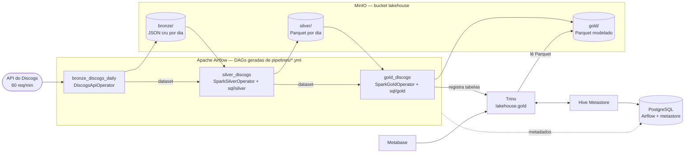

# Discogs Data Lake

Lakehouse local com dados da [API do Discogs](https://www.discogs.com/developers/), organizado em camadas
**Bronze → Silver → Gold**. A peça central é um **snapshot diário** de demanda (`have`/`want`) e preço
(menor oferta em USD) de um conjunto de releases acompanhados. Isso permite ver tendências ao longo do tempo,
além de coleções e wantlists de usuários.

As DAGs são **declarativas**: cada arquivo em `pipelines/*.yml` vira uma DAG do Airflow. Ali ficam o
agendamento, a DAG upstream, as tarefas, o operador de cada uma e os checks de qualidade. Na silver e na gold,
cada tarefa gera uma tabela a partir de um arquivo SQL.

## Ferramentas

<table>
  <tr>
    <td align="center" width="110"><br/><b>Airflow 2.9</b><br/><sub>orquestração</sub></td>
    <td align="center" width="110"><br/><b>Spark 3.5</b><br/><sub>transformação</sub></td>
    <td align="center" width="110"><br/><b>MinIO</b><br/><sub>armazenamento S3</sub></td>
    <td align="center" width="110"><br/><b>Hive Metastore 4</b><br/><sub>catálogo</sub></td>
    <td align="center" width="110"><br/><b>Trino</b><br/><sub>consulta SQL</sub></td>
  </tr>
  <tr>
    <td align="center" width="110"><br/><b>Metabase</b><br/><sub>visualização</sub></td>
    <td align="center" width="110"><br/><b>PostgreSQL 16</b><br/><sub>metadados</sub></td>
    <td align="center" width="110"><br/><b>Python 3.11</b><br/><sub>coleta e operadores</sub></td>
    <td align="center" width="110"><br/><b>Docker Compose</b><br/><sub>ambiente local</sub></td>
    <td align="center" width="110"><b>API Discogs</b><br/><sub>fonte de dados</sub></td>
  </tr>
</table>

## Arquitetura



### Camadas e DAGs


- **Bronze** (`DiscogsApiOperator`): ingestão pela API, sem SQL. O YAML escolhe o coletor (`discovery`,
  `user_lists`, `snapshot`, `new_entities`). Cada execução grava o JSON cru em `bronze/<entidade>/dt=<ds>/`.
- **Silver** (`SparkSilverOperator`): cada tarefa lê as fontes `bronze_*` citadas no seu SQL, usando o schema
  declarado no YAML, e grava `silver/<tabela>/dt=<ds>/`. Roda quando a bronze termina e processa a mesma data.
- **Gold** (`SparkGoldOperator`): cada tarefa lê as tabelas `silver_*` citadas no SQL, reconstrói
  `gold/<tabela>/` e registra a tabela no Trino (`lakehouse.gold`) como tabela externa no Hive Metastore.
- Os dois operadores Spark compartilham a mesma base (`SparkSqlOperator`): sessão Spark, execução do SQL,
  gravação e checks. Cada subclasse muda só o que é próprio da camada.

## Estrutura

```
pipelines/                 uma DAG por arquivo YAML
  bronze_discogs_discovery.yml
  bronze_discogs_daily.yml
  silver_discogs.yml       fontes bronze (schemas) + tabelas
  gold_discogs.yml
sql/
  silver/<tabela>.sql      uma tabela por arquivo
  gold/<tabela>.sql
dags/pipelines.py          lê pipelines/*.yml e cria as DAGs (não precisa ser editado)
src/discogs_pipeline/
  spec.py                  leitura e validação dos YAML (sem Airflow)
  dag_factory.py           YAML -> DAG do Airflow
  operators/               um operador por tipo de transformação
    base.py                LakeOperator: configuração e data da partição
    ingestion.py           DiscogsApiOperator (bronze)
    spark.py               SparkSqlOperator -> SparkSilverOperator / SparkGoldOperator
  transform.py             núcleo Spark: registra views, executa SQL, grava, roda checks
  collectors/              coletores da API (discovery, users, snapshot, entities)
  api.py                   cliente com rate limit, novas tentativas e paginação
config/tracking.yml        usernames, sementes de discovery e limites
tests/unit                 sem Docker (Spark local)
tests/integration          dentro do container do Airflow, com a stack no ar
```

## Declarando uma DAG

```yaml
# pipelines/gold_discogs.yml
dag_id: gold_discogs
layer: gold                      # bronze | silver | gold
schedule:
  after: [silver_discogs]        # roda quando essa DAG termina (dataset); ou "@daily", cron, null
max_active_tasks: 2              # cada tarefa Spark abre uma JVM
tasks:
  fact_release_snapshot:
    operator: spark_gold         # discogs_api | spark_silver | spark_gold
    sql: gold/fact_release_snapshot.sql   # opcional: o padrão é <layer>/<tarefa>.sql
    partition_by: dt_snapshot
    upstream: []                 # tarefas da mesma DAG
    checks: {unique: [id_release, dt_snapshot], not_null: [id_release], min_rows: 1}
```

**Nova tabela:** crie `sql/<camada>/<nome>.sql` e acrescente a tarefa no YAML da camada.

A validação roda quando o Airflow lê as DAGs e nos testes. Uma DAG com erro aparece como *import error* no
Airflow, em vez de quebrar em execução. A validação confere:
- se o operador existe e serve para a camada;
- se os parâmetros obrigatórios foram informados;
- se o `upstream` existe e não forma ciclo;
- se a DAG de `after` existe e se o arquivo SQL existe;
- se toda view citada no SQL (`bronze_*` ou `silver_*`) foi declarada.

## Modelo Gold

| Tabela | Grão | Origem |
|---|---|---|
| `fact_release_snapshot` | release × dia (partição `dt_snapshot`) | `community.have/want`, `rating`; `marketplace/stats` (`vl_lowest_price_usd`, `qt_for_sale`). Preço nulo = nada à venda |
| `dim_release` | release | atributos; gênero, estilo e formato = **primeiro valor** da lista |
| `dim_master` | master (agrupa edições) | `/masters/{id}`; nem todo release tem master: use `LEFT JOIN` |
| `dim_artist`, `dim_label` | artista, gravadora | `/artists/{id}`, `/labels/{id}` (com gravadora-mãe) |
| `bridge_release_artist` | release × artista | `artists[]` do release, com posição no crédito |
| `dim_track` | release × faixa | `tracklist[]`, duração em segundos; títulos de lado são removidos |
| `fact_collection_item` | cópia na coleção (`id_instance`) | estado atual por usuário |
| `fact_wantlist_item` | release na wantlist | estado atual por usuário |
| `ctl_tracked_release` | release acompanhado | origem (`discovery:…`, `collection:…`, `wantlist:…`) |
| `dim_date` | dia | calendário do período com snapshots |

Prefixos de coluna: `id_` chave, `dt_` data, `ts_` timestamp, `qt_` quantidade, `vl_` valor, `nm_` nome,
`ds_` descrição, `nr_` número, `cd_` código, `fl_` booleano.

**Como a coleta funciona:**
- **Discovery**: a busca do Discogs só devolve IDs de *release*. Artistas, gravadoras e masters saem do
  detalhe de cada release e são coletados uma única vez.
- **Conjunto acompanhado**: a discovery e as listas de usuários só *acrescentam* releases. Nenhum sai, então
  as séries históricas ficam completas.
- **Custo**: 2 chamadas por release por dia. Com o limite de 60 req/min, 500 releases levam cerca de 17 minutos.
- **Falhas**: falhas pontuais ficam para o dia seguinte. Se passarem de `max_failure_ratio`, a tarefa falha.

## Executando

1. Crie o `.env` e preencha `DISCOGS_TOKEN` (de <https://www.discogs.com/settings/developers>) e as senhas:
   ```bash
   cp .env.example .env
   ```
2. Ajuste `config/tracking.yml`: usernames, sementes de discovery e limites.
3. Suba a stack (a primeira build baixa ~5 GB de imagens):
   ```bash
   docker compose up -d --build
   ```
4. No Airflow (<http://localhost:8080>, com o usuário e a senha do `.env`):
   1. Despause e rode `bronze_discogs_discovery` uma vez.
   2. Despause `bronze_discogs_daily`, `silver_discogs` e `gold_discogs`. A silver e a gold disparam sozinhas
      quando a camada anterior termina. Para reprocessar um dia, dispare a silver com o conf `{"ds": "AAAA-MM-DD"}`.
5. Consulte:
   - **Trino**: `localhost:8081`, catálogo `lakehouse`, schema `gold`.
   - **Metabase**: <http://localhost:3000>. Adicione um banco **Starburst** com host `trino`, porta `8080`,
     catálogo `lakehouse` e schema `gold`.
   - **MinIO**: console em <http://localhost:9001>.

```sql
-- Releases cuja demanda mais cresceu nos últimos 30 dias
SELECT r.ds_title, a.nm_artist_credit,
       MAX_BY(s.qt_want, s.dt_snapshot) - MIN_BY(s.qt_want, s.dt_snapshot) AS ganho_want
FROM lakehouse.gold.fact_release_snapshot s
JOIN lakehouse.gold.dim_release r USING (id_release)
LEFT JOIN lakehouse.gold.bridge_release_artist a ON a.id_release = s.id_release AND a.nr_position = 1
WHERE s.dt_snapshot >= current_date - INTERVAL '30' DAY
GROUP BY 1, 2
ORDER BY ganho_want DESC
LIMIT 20;
```

## Testes

**Unitários** (sem Docker; o Spark local precisa de Java 17+). Cobrem o cliente da API, os coletores, a
validação dos YAML e a silver e a gold de ponta a ponta com os YAML e SQL reais, incluindo os checks e o DDL do Trino:

```bash
python3 -m venv .venv && .venv/bin/pip install pyspark==3.5.1 boto3 requests pyyaml pytest trino
```

```bash
.venv/bin/python -m pytest tests/unit
```

**Integração** (com a stack no ar). Usam o bucket `lakehouse-it` e o schema `gold_it`, separados dos dados reais.
Conferem:
- se as DAGs carregam sem erro e seguem os YAML (tarefas, dependências, operadores e o encadeamento por datasets);
- o fluxo completo pelos operadores do Airflow: bronze no MinIO → silver → gold → consultas no Trino.

```bash
docker compose exec airflow-scheduler python -m pytest tests/integration
```

---

**Desenvolvido por:** Vitor Musachio
