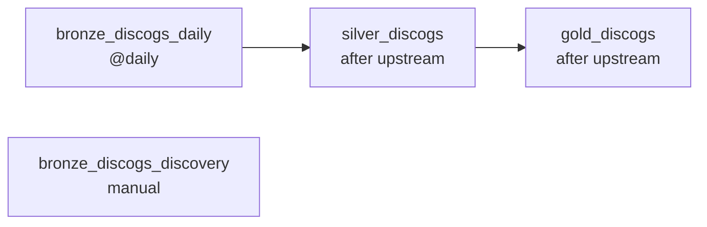
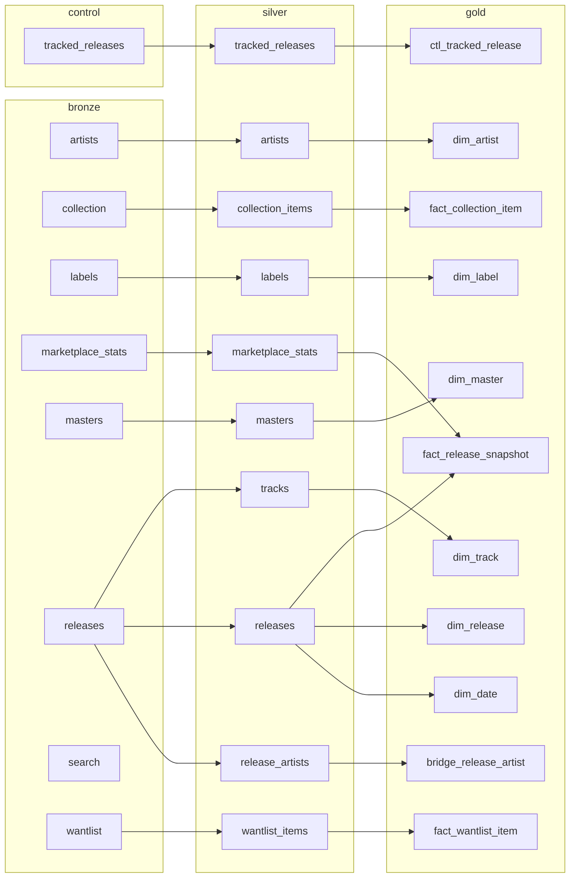

# Lineage

<!-- Generated by `make lineage` from pipelines/*.yml and sql/**. Do not edit by hand. -->

## DAGs

## Datasets

## Dependencies

| Dataset | Produced by | Upstream | Downstream |
|---|---|---|---|
| `control.tracked_releases` | `bronze_discogs_daily.user_lists`, `bronze_discogs_discovery.discovery` | — | `silver.tracked_releases` |
| `bronze.artists` | `bronze_discogs_daily.new_entities` | — | `silver.artists` |
| `bronze.collection` | `bronze_discogs_daily.user_lists` | — | `silver.collection_items` |
| `bronze.labels` | `bronze_discogs_daily.new_entities` | — | `silver.labels` |
| `bronze.marketplace_stats` | `bronze_discogs_daily.snapshot` | — | `silver.marketplace_stats` |
| `bronze.masters` | `bronze_discogs_daily.new_entities` | — | `silver.masters` |
| `bronze.releases` | `bronze_discogs_daily.snapshot` | — | `silver.release_artists`, `silver.releases`, `silver.tracks` |
| `bronze.search` | `bronze_discogs_discovery.discovery` | — | — |
| `bronze.wantlist` | `bronze_discogs_daily.user_lists` | — | `silver.wantlist_items` |
| `silver.artists` | `silver_discogs.artists` | `bronze.artists` | `gold.dim_artist` |
| `silver.collection_items` | `silver_discogs.collection_items` | `bronze.collection` | `gold.fact_collection_item` |
| `silver.labels` | `silver_discogs.labels` | `bronze.labels` | `gold.dim_label` |
| `silver.marketplace_stats` | `silver_discogs.marketplace_stats` | `bronze.marketplace_stats` | `gold.fact_release_snapshot` |
| `silver.masters` | `silver_discogs.masters` | `bronze.masters` | `gold.dim_master` |
| `silver.release_artists` | `silver_discogs.release_artists` | `bronze.releases` | `gold.bridge_release_artist` |
| `silver.releases` | `silver_discogs.releases` | `bronze.releases` | `gold.dim_date`, `gold.dim_release`, `gold.fact_release_snapshot` |
| `silver.tracked_releases` | `silver_discogs.tracked_releases` | `control.tracked_releases` | `gold.ctl_tracked_release` |
| `silver.tracks` | `silver_discogs.tracks` | `bronze.releases` | `gold.dim_track` |
| `silver.wantlist_items` | `silver_discogs.wantlist_items` | `bronze.wantlist` | `gold.fact_wantlist_item` |
| `gold.bridge_release_artist` | `gold_discogs.bridge_release_artist` | `silver.release_artists` | — |
| `gold.ctl_tracked_release` | `gold_discogs.ctl_tracked_release` | `silver.tracked_releases` | — |
| `gold.dim_artist` | `gold_discogs.dim_artist` | `silver.artists` | — |
| `gold.dim_date` | `gold_discogs.dim_date` | `silver.releases` | — |
| `gold.dim_label` | `gold_discogs.dim_label` | `silver.labels` | — |
| `gold.dim_master` | `gold_discogs.dim_master` | `silver.masters` | — |
| `gold.dim_release` | `gold_discogs.dim_release` | `silver.releases` | — |
| `gold.dim_track` | `gold_discogs.dim_track` | `silver.tracks` | — |
| `gold.fact_collection_item` | `gold_discogs.fact_collection_item` | `silver.collection_items` | — |
| `gold.fact_release_snapshot` | `gold_discogs.fact_release_snapshot` | `silver.marketplace_stats`, `silver.releases` | — |
| `gold.fact_wantlist_item` | `gold_discogs.fact_wantlist_item` | `silver.wantlist_items` | — |

Written but not read by any task (kept for lineage and debugging): `bronze.search`.
